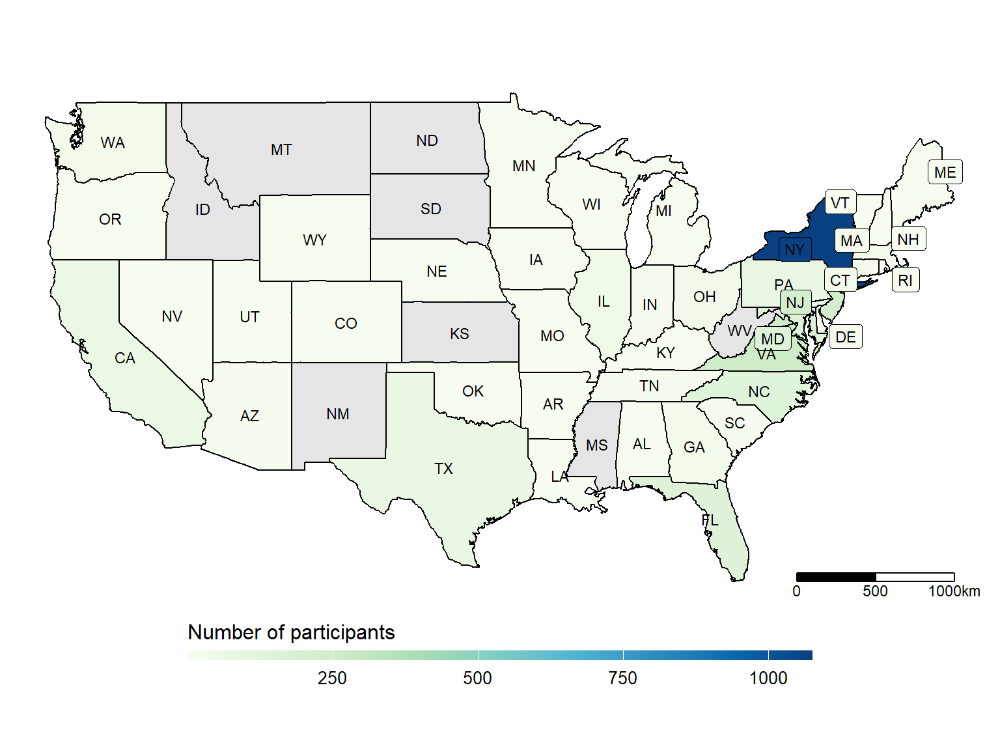
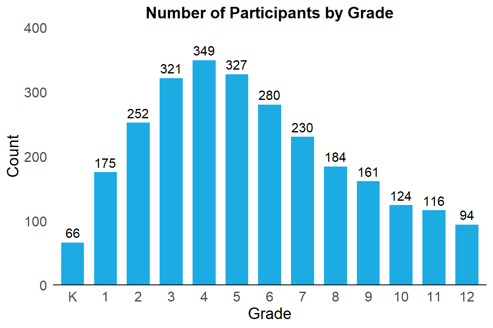
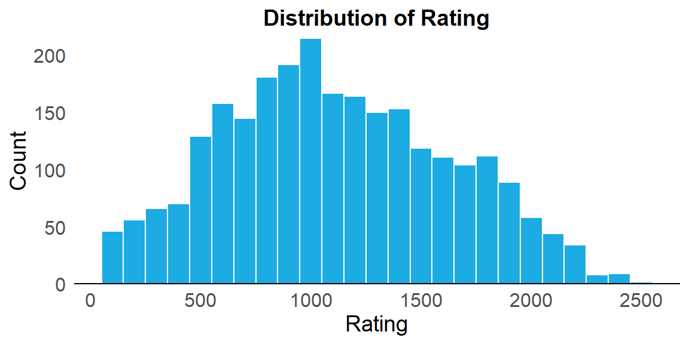
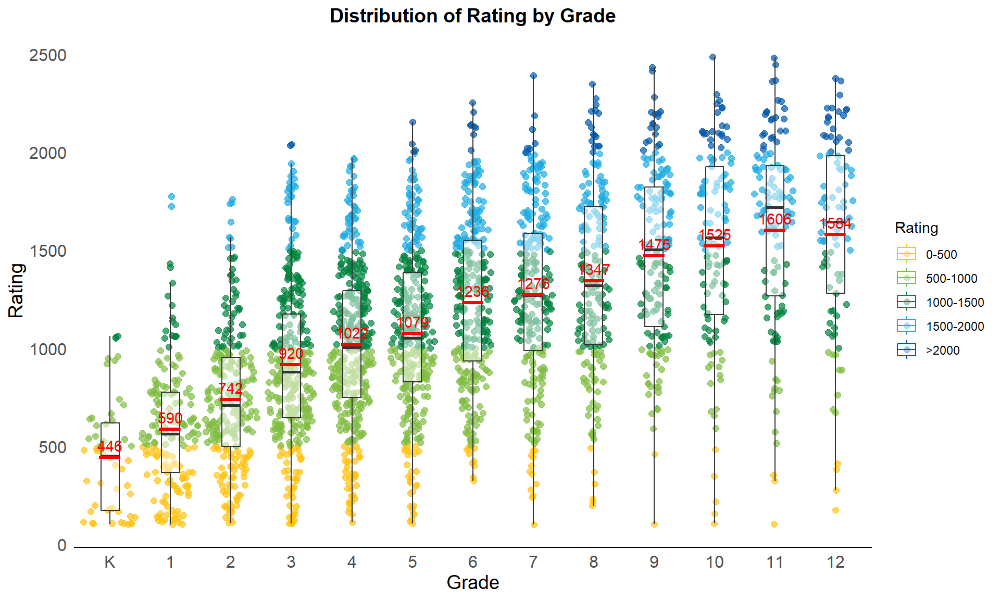
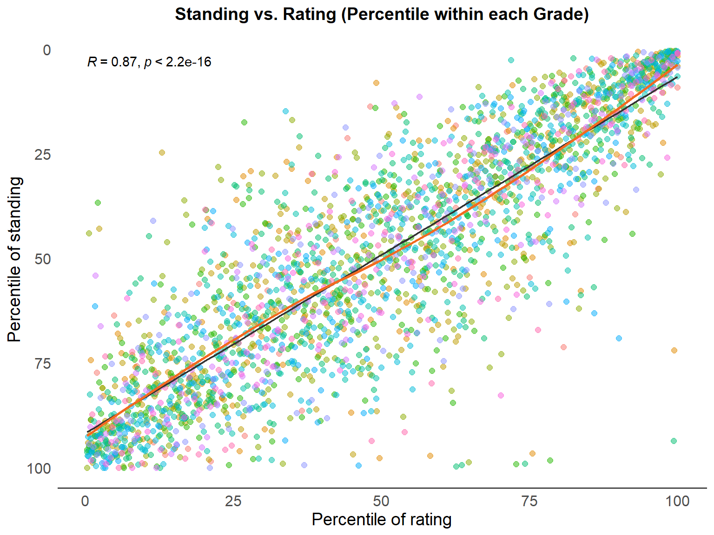
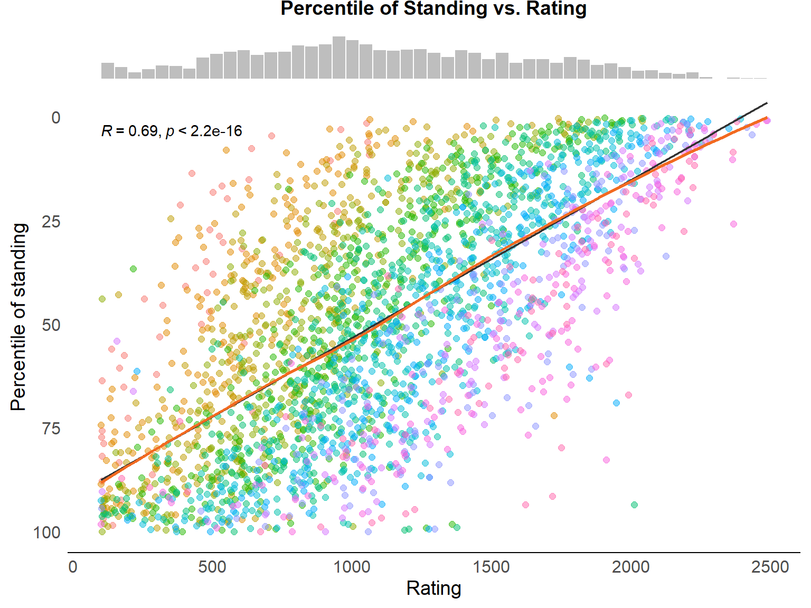
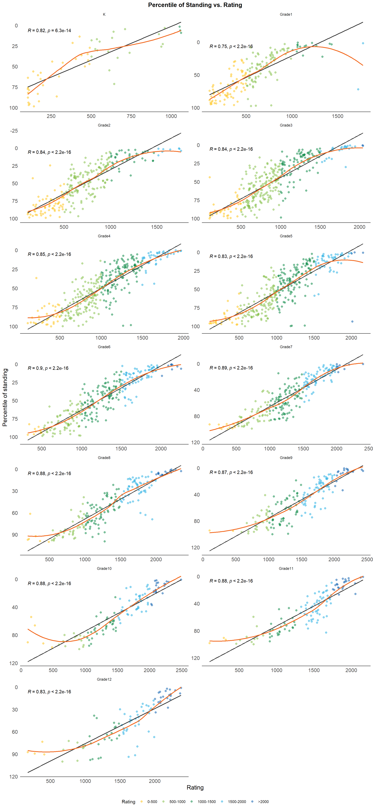
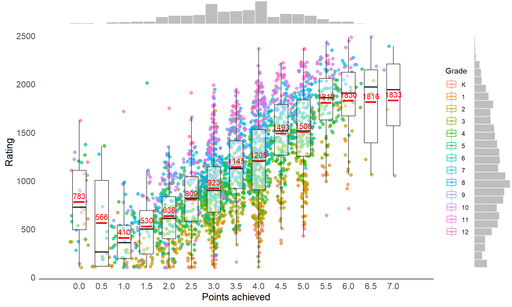
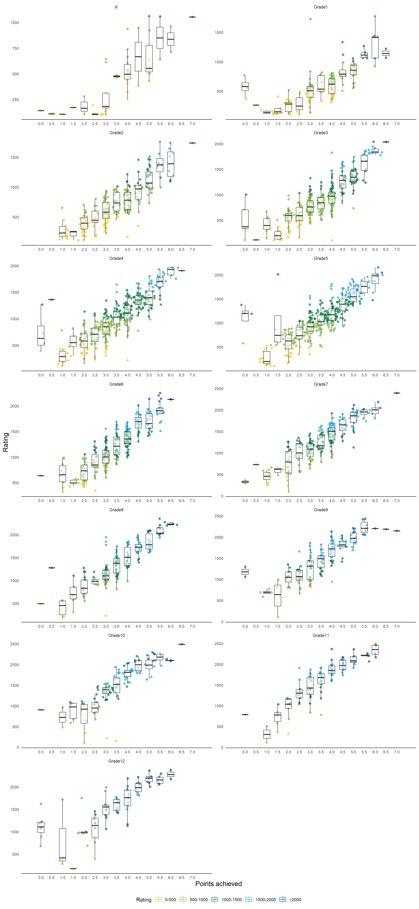

The 2024 National K-12 Grades Championship drew more than 2,600 players from 43 states. This note summarizes participation patterns by state and grade, then checks how strongly player rating predicts final standing.

Data source: [US Chess 2024 National K-12 Grades Championship results](https://www.uschess.org/results/2024/k12/).

<h1>Over 2,600 contestants from 43 states participated in the 2024 National K-12 Grades Championship</h1>

The 2024 National K-12 Grades Championship attracted a total of 2,679 participants from 43 states. More than 1,000 participants (40%) came from New York, followed by Virginia with 250 participants (9%) and New Jersey with 218 participants (8%).

<h2>Fourth grade (age 9) had the largest field, with nearly 350 participants.</h2>

Grades 3, 4, and 5 have the highest number of participants, while Grade K has the fewest.

<h2>11th grade had the highest average rating, around 1,600.</h2>

The average rating of more than 2,600 participants is 1,115, with a median of 1,062 and a standard deviation of 514. Ninety percent of the participants have ratings between 300 and 1,989.

The plot below shows the distribution of ratings across grades. The mean is indicated by the red bar, and the black bars in the boxplot represent the median.

<h2>Does a higher rating guarantee a higher standing?</h2>

Not necessarily. To make the data comparable across grades, I standardized standings by calculating each player's percentile within grade, scaled from 0 to 100. I also calculated rating percentiles within grade, although that extra standardization is not needed when looking at a single grade.

The plot below illustrates the relationship between standing and rating, both standardized within each grade, with different colors representing different grades.

While the correlation between standardized rating and percentile is indeed strong, it may not be as strong as some might expect. Although the correlation is statistically significant due to the large sample size, the R-squared value (from a fitted linear regression) is only 0.75. This indicates that the relationship isn’t as robust as it might initially appear. There is substantial variation in standing within each rating percentile. Outliers—such as cases where a high-ranked player drops out mid-match—further weaken the correlation.

The red lines in the chart represent a LOESS (locally estimated scatterplot smoothing) curve, providing a non-linear fit.

<h3>Rating without standardization</h3>

<h2>Standing percentile vs. rating percentile by grade</h2>
<iframe src="https://liuyanguu.shinyapps.io/K12_National_Standing_vs_Rating/?showcase=0" width="1152" height="600px" data-external="1">
</iframe>

<h3>Colored by rating category</h3>

<h2>Points achieved vs. rating</h2>

Points achieved determined the final standings. This provides another perspective on the variation in ratings among participants who achieved the same number of points.

<strong>The histogram at the top also shows that most players scored 3 or 4 points.</strong>

<h2>Points achieved vs. rating by grade</h2>

Related note: <a href="https://twitter.com/liuyanguu/status/1868839933550694629">standing and rating chart shared on X/Twitter</a>.

