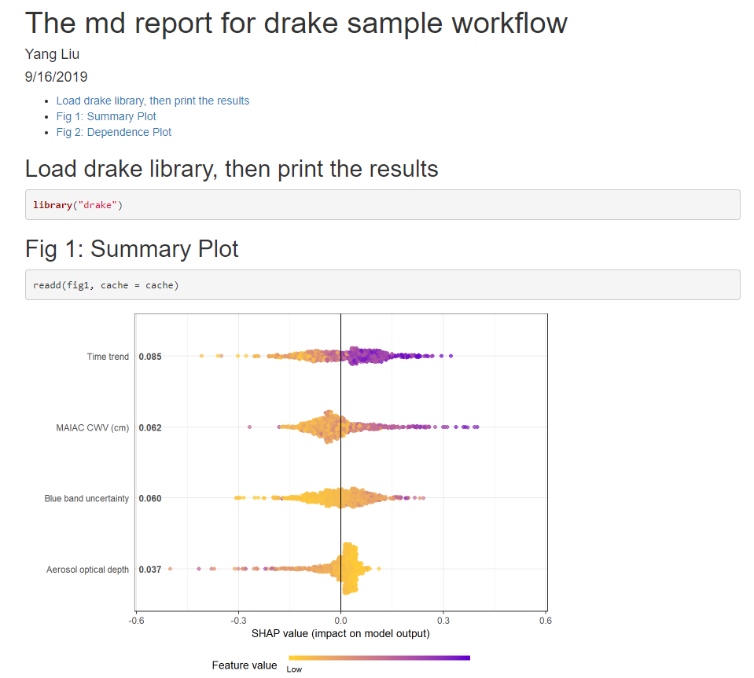

<strong><code>drake</code></strong> is a powerful tool for reproducible R workflows. I found it especially useful when paired with R Markdown reports, because it can cache expensive intermediate results and only rebuild the objects that have changed.

<strong>Maintenance note:</strong> this is a legacy <code>drake</code> example. For new R workflow projects I would usually look at <code>targets</code>, which follows the same core idea with a newer interface. I am keeping the original <code>drake</code> code here because the example is still useful for understanding target-based workflows.

Using <code>SHAPforxgboost</code> as an example:

<pre class="r"><code># if needed, update drake
if(packageVersion(&quot;drake&quot;) &lt; &quot;7.4&quot;) install.packages(&quot;drake&quot;)
if(packageVersion(&quot;SHAPforxgboost&quot;) &lt; &quot;0.0.3&quot;) install.packages(&quot;SHAPforxgboost&quot;)

suppressPackageStartupMessages({
  library(&quot;drake&quot;)
  library(&quot;SHAPforxgboost&quot;)
  library(&quot;here&quot;)
})

# assign a place to store intermediate objects
cache_path &lt;- here(&quot;Drake_Cache&quot;)
if(!dir.exists(cache_path))dir.create(cache_path)
cache &lt;- drake_cache(path = cache_path)</code></pre>

The <strong>drake_plan</strong> takes user-defined functions to create each target. These functions are usually written in a separate script.

<pre class="r"><code>get.xgb.mod &lt;- function(dataX){
  y_var &lt;- &quot;diffcwv&quot; 
  # hyperparameter tuning results
  param_dart &lt;- list(objective = &quot;reg:linear&quot;,  # For regression
                   nrounds = 366,
                   eta = 0.018,
                   max_depth = 10,
                   gamma = 0.009,
                   subsample = 0.98,
                   colsample_bytree = 0.86)

  mod &lt;- xgboost::xgboost(data = as.matrix(dataX), 
                        label = as.matrix(dataXY_df[[y_var]]), 
                       xgb_param = param_dart, nrounds = param_dart$nrounds,
                       verbose = FALSE, nthread = parallel::detectCores() - 2,
                       early_stopping_rounds = 8)
  return(mod)
}

# ...
# define more functions if needed
# ...</code></pre>

Markdown all the results to the final report. The great advantage is that since all the figures were done and stored before the markdown process, if you modify a figure, only that figure needs to be rerun.

<pre class="r"><code>my_plan &lt;- drake_plan(
  dataX = data.table::copy(dataXY_df[,-&quot;diffcwv&quot;]),
  xgb_mod = get.xgb.mod(dataX),
  shap_long = shap.prep(xgb_model = xgb_mod, X_train = dataX, top_n = 4),
  # make a diluted (faster) summary plot showing only top 4 variables:
  fig1 = shap.plot.summary(shap_long, dilute = 10),
  fig2 = shap.plot.dependence(data_long = shap_long, x = &#39;dayint&#39;, y = &#39;dayint&#39;, color_feature = &#39;Column_WV&#39;),
  fig3 = shap.plot.dependence(data_long = shap_long, x = &#39;dayint&#39;, y = &#39;Column_WV&#39;, color_feature = &#39;Column_WV&#39;),
  
  report = rmarkdown::render(
    knitr_in(&quot;Code/drake_md_report.Rmd&quot;),
    output_format = rmarkdown::html_document(toc = TRUE))
)

nemia_config &lt;- drake_config(my_plan, cache = cache) # show the dependency
# vis_drake_graph(nemia_config, from = names(nemia_config$layout))
vis_drake_graph(nemia_config)

# run the plan
make(my_plan, cache = cache)</code></pre>

Notice that it is not a good idea to run <code>drake</code> inside an R Markdown file. A <code>drake</code> workflow is usually an R script that uses R Markdown only as the reporting layer.

Here is how the dependency graph looks like:

If we add an extra figure, only this figure (the black <em>fig3</em>) needs to made:

Here is <a href="https://github.com/liuyanguu/Blogdown/blob/master/hugo-xmag/Code/drake_md_report.Rmd">how the md file looks like on GitHub</a>

The <code>drake</code> work plan then generates the HTML report automatically (<code>drake_md_report.html</code>), which looks like this:

