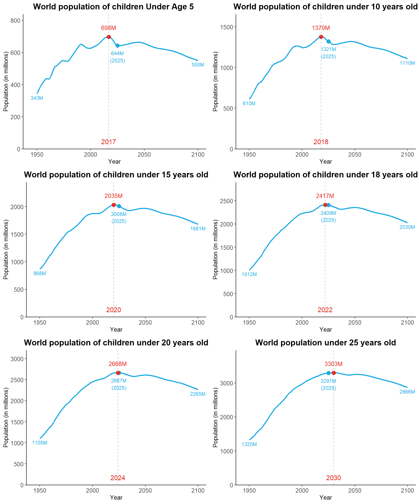
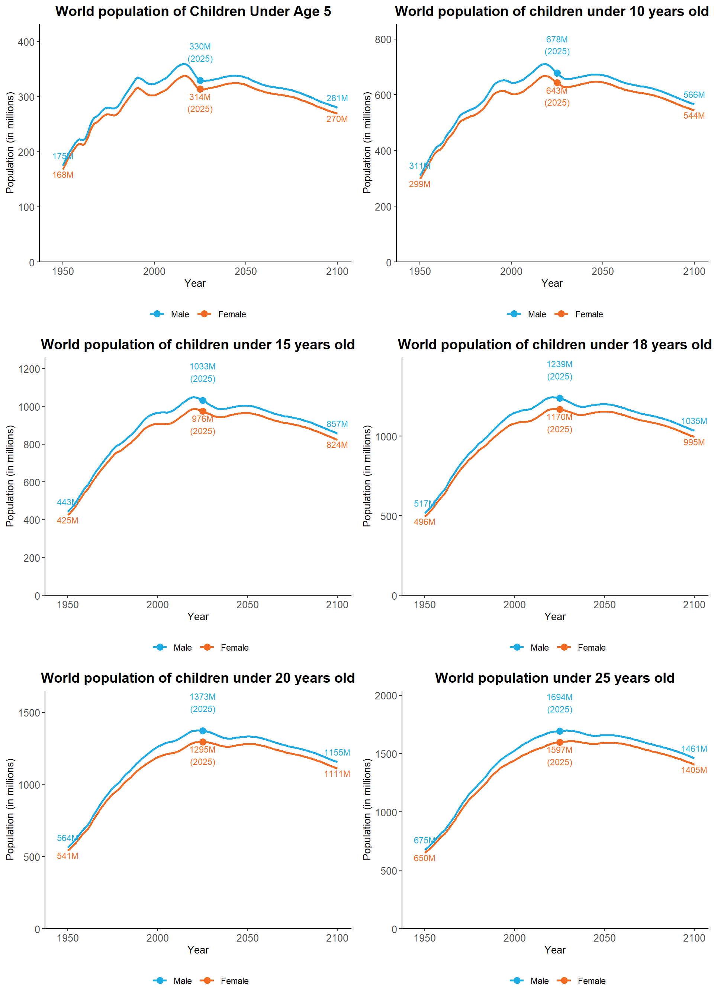
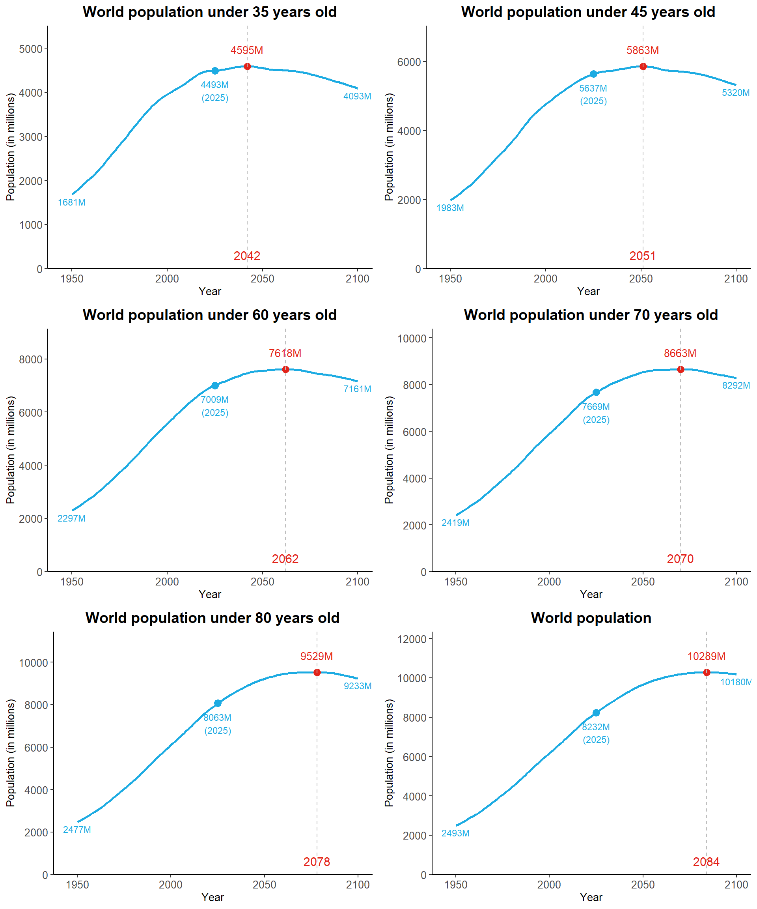

I wanted a quick reference for common child and youth age-group totals, so I summarized the UN World Population Prospects (WPP) 2024 mid-year estimates.

<strong>World population:</strong> In 2024, the world population is estimated at 8.2 billion (8,162 million). It is projected to peak in 2084 at 10.3 billion.

<strong>Children under age 5:</strong> The number of children under 5 is 647 million in 2024. This figure peaked in 2017 at 698 million and is projected to decline to 550 million by 2100.

<strong>Children aged 0-14:</strong> The population aged 0-14 peaked in 2020 and stands at 2.0 billion in 2024.

<strong>Children and adolescents under age 18:</strong> The population aged 0-17 peaked in 2022 and stands at 2.4 billion (2,413 million) in 2024.

<strong>Children and adolescents under age 20:</strong> The population aged 0-19 is 2.7 billion (2,668 million) in 2024, which is the peak year for this age group.

<strong>Population under age 25:</strong> The population aged 0-24 is 3.3 billion in 2024. It is projected to increase slightly and peak in 2030.

<strong>World population under ages 5, 10, 15, 18, 20, and 25 (millions)</strong>

<table>
<colgroup>
<col width="29%" />
<col width="15%" />
<col width="9%" />
<col width="9%" />
<col width="9%" />
<col width="9%" />
<col width="9%" />
<col width="9%" />
</colgroup>
<thead>
<tr class="header">
<th align="left">Population</th>
<th align="left">Age Group</th>
<th align="left">2015</th>
<th align="left">2020</th>
<th align="left">2025</th>
<th align="left">2030</th>
<th align="left">2050</th>
<th align="left">2100</th>
</tr>
</thead>
<tbody>
<tr class="odd">
<td align="left">Under 5 years old</td>
<td align="left">0-4</td>
<td align="left">696</td>
<td align="left">683</td>
<td align="left">644</td>
<td align="left">645</td>
<td align="left">656</td>
<td align="left">550</td>
</tr>
<tr class="even">
<td align="left">Under 10 years old</td>
<td align="left">0-9</td>
<td align="left">1,358</td>
<td align="left">1,374</td>
<td align="left">1,321</td>
<td align="left">1,283</td>
<td align="left">1,316</td>
<td align="left">1,110</td>
</tr>
<tr class="odd">
<td align="left">Under 15 years old</td>
<td align="left">0-14</td>
<td align="left">1,988</td>
<td align="left">2,035</td>
<td align="left">2,008</td>
<td align="left">1,958</td>
<td align="left">1,969</td>
<td align="left">1,681</td>
</tr>
<tr class="even">
<td align="left">Under 18 years old</td>
<td align="left">0-17</td>
<td align="left">2,355</td>
<td align="left">2,413</td>
<td align="left">2,409</td>
<td align="left">2,370</td>
<td align="left">2,357</td>
<td align="left">2,030</td>
</tr>
<tr class="odd">
<td align="left">Under 20 years old</td>
<td align="left">0-19</td>
<td align="left">2,597</td>
<td align="left">2,662</td>
<td align="left">2,667</td>
<td align="left">2,643</td>
<td align="left">2,613</td>
<td align="left">2,265</td>
</tr>
<tr class="even">
<td align="left">Under 25 years old</td>
<td align="left">0-24</td>
<td align="left">3,206</td>
<td align="left">3,267</td>
<td align="left">3,291</td>
<td align="left">3,303</td>
<td align="left">3,251</td>
<td align="left">2,866</td>
</tr>
</tbody>
</table>

<strong>The same age groups, by sex</strong>

<strong>Total world population</strong>

Source: <a href="https://population.un.org/wpp/downloads?folder=Standard%20Projections&amp;group=CSV%20format">World Population Prospects (WPP) 2024</a>. Population on 1 July, by single-year age group.

