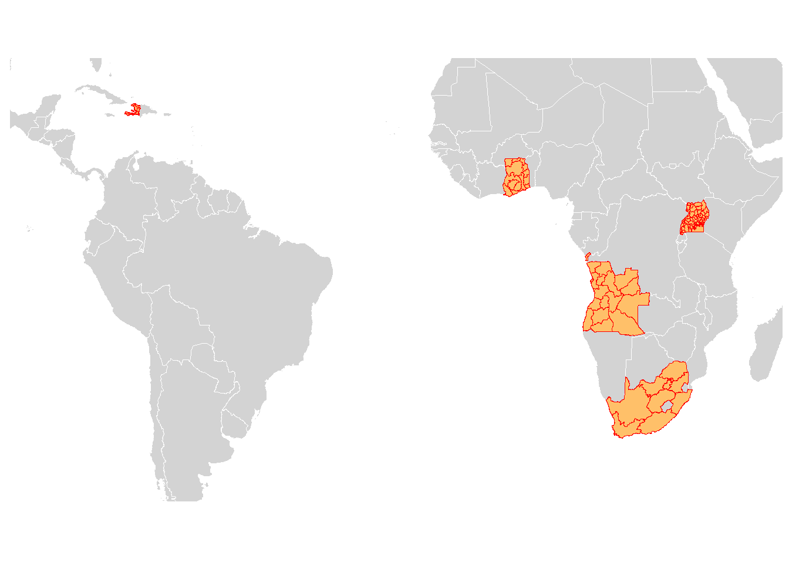
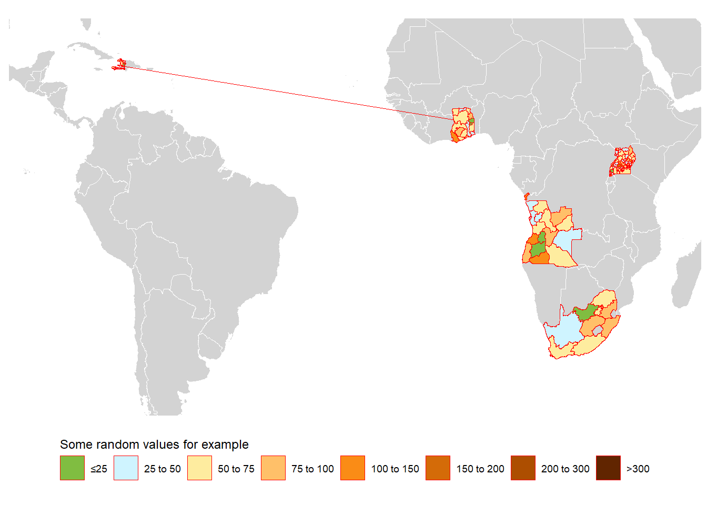
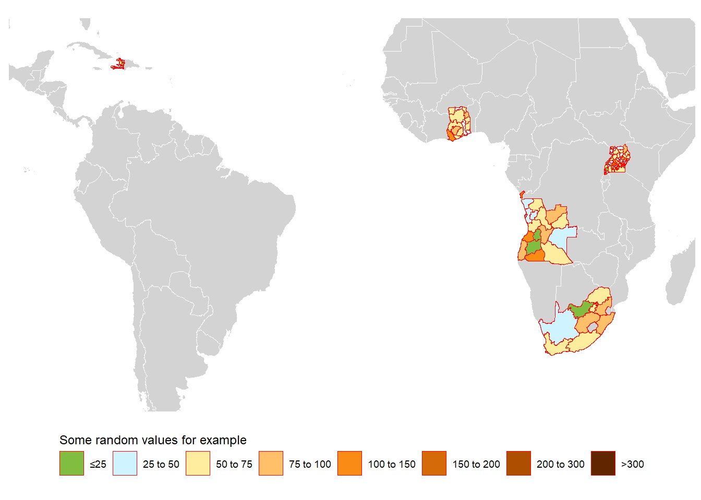

This post shows how to download and plot administrative areas from multiple countries on a world map. The main lesson is a subtle plotting bug: if region names are not unique across countries, <code>ggplot2::geom_polygon()</code> can draw strange connecting lines between unrelated areas.

<strong>Maintenance note:</strong> this example preserves the original <code>sp</code>/<code>raster</code> workflow. For new spatial work in R, <code>sf</code>, <code>terra</code>, and <code>geodata</code> are usually easier to maintain, but the polygon-grouping issue shown here is still relevant.

<h1>The basic map</h1>

(You may download the world map from <a href="https://github.com/liuyanguu/Blogdown/tree/ef15e72d86d99cd538a591780822226de664e6f5/Data">GitHub</a>)

<pre class="r"><code>suppressPackageStartupMessages({
library(&quot;data.table&quot;)
library(&quot;ggplot2&quot;)
library(&quot;rgdal&quot;)
library(&quot;raster&quot;)
library(&quot;rgeos&quot;)
library(&quot;here&quot;)
library(&quot;ggthemes&quot;)
})

# download data from GADM directly and row-bind the spatial polygons data frame
cnames &lt;- c(&quot;Haiti&quot;, &quot;Togo&quot;, &quot;Uganda&quot;, &quot;Ghana&quot;, &quot;South Africa&quot;, &quot;Angola&quot;)
download.GADM &lt;- function(cname0) raster::getData(&quot;GADM&quot;, country = cname0, level = 1)
dt_geos &lt;- raster::bind(lapply(cnames, download.GADM))
dt_geos &lt;- sp::spTransform(dt_geos, CRS(&quot;+proj=robin&quot;)) # robin transformation
dt_geos_df &lt;- broom::tidy(dt_geos, region = &quot;GID_1&quot;)

  x_min &lt;- min(dt_geos_df$long)*1.2
  x_max &lt;- max(dt_geos_df$long)*1.2
  y_min &lt;- min(dt_geos_df$lat)* 1.2
  y_max &lt;- max(dt_geos_df$lat)* 1.2
  
  map_theme &lt;- ggthemes::theme_map() +
    theme(legend.position = &quot;bottom&quot;, legend.direction = &quot;horizontal&quot;, legend.justification = c(&quot;center&quot;))
  
  shp_world_robin &lt;- readRDS(here::here(&quot;../Data/World.shp/sp.world.robin.rds&quot;)) # this has to be sourced locally
  ggplot() +
    geom_polygon(data = shp_world_robin, aes(x = long, y = lat, group = group), fill=&quot;lightgray&quot;, 
                 colour = &quot;white&quot;, size=0.05) +
    geom_polygon(data = dt_geos, aes(x = long, y = lat, group = group), 
                 color = &quot;red&quot;, size=0.05, fill=&quot;#ffc069&quot;)  +
    # if want to crop map:
    coord_fixed(xlim=c(x_min, x_max), ylim=c(y_min, y_max)) +
    map_theme +
    guides(fill = guide_legend(nrow = 1, title.position = &quot;top&quot;))</code></pre>

<h1>Mapping values by administrative area</h1>

Next, we add values to the map. These values can be merged directly to the spatial polygons object or to a data frame derived from it. Here I show the second approach: transform the <em>sp</em> object into a data frame first, then supply that data frame to <code>ggplot2::geom_polygon()</code>.

In GADM admin 1 files, <code>GID_1</code> is a unique identifier even after binding multiple countries. To make the bug visible, this example intentionally uses region names from <code>NAME_1</code> as the region identifier. In my applied work, I sometimes had to merge estimates using those names.

<pre class="r"><code># `region` will become the id/group used to identify each area 
# Either broom::tidy or ggplot2::fortify can work:
# dt_geos_data &lt;- broom::tidy(dt_geos, region = &quot;NAME_1&quot;)
# dt_geos_data &lt;- ggplot2::fortify(dt_geos, region = &quot;NAME_1&quot;)

download.GADM.df &lt;- function(cname0){
  dfsp &lt;- raster::getData(&quot;GADM&quot;, country = cname0, level = 1) # download data from GADM
  dfsp &lt;- sp::spTransform(dfsp, CRS(&quot;+proj=robin&quot;)) # robin transformation
  dfsf &lt;- broom::tidy(dfsp, region = &quot;NAME_1&quot;) # get df
  dfsf$country &lt;- cname0 # add a country identifier 
  return(setDT(dfsf))
}

dt_geos_data &lt;- rbindlist(lapply(cnames, download.GADM.df))

# imagine we want to plot estimates, not only the map
dt_admin1 &lt;- unique(setDT(dt_geos_data)[,.(country, id)])
set.seed(1234)
dt_admin1$value &lt;- rgamma(nrow(dt_admin1), shape = 4, scale = 15) # some random values

setkey(dt_geos_data, country, id)
setkey(dt_admin1, country, id)
dt_geos_data_value &lt;- dt_geos_data[dt_admin1]

legend_break &lt;- c(0, 25, 50, 75,  100, 150, 200, 300, 500)
legend_label &lt;- c(&quot;≤25&quot;, &quot;25 to 50&quot;, &quot;50 to 75&quot;, &quot;75 to 100&quot;, &quot;100 to 150&quot;,&quot;150 to 200&quot;,&quot;200 to 300&quot;,&quot;&gt;300&quot;)
legend_color &lt;- c(&quot;#80BD41&quot;, &quot;#CFF4FF&quot;,&quot;#feec9f&quot;,&quot;#ffc069&quot;,&quot;#fa8c16&quot;,&quot;#d46b08&quot;,&quot;#ad4e00&quot;,&quot;#612500&quot;)
dt_geos_data_value$col &lt;- cut(dt_geos_data_value$value, breaks = legend_break, labels = legend_label)</code></pre>

<h1>The bug: strange connecting lines</h1>
<pre class="r"><code>ggplot() +
  geom_polygon(data = shp_world_robin, aes(x = long, y = lat, group = group), fill=&quot;lightgray&quot;, 
               colour = &quot;white&quot;, size=0.05) +
  geom_polygon(data = dt_geos_data_value, aes(x = long, y = lat, group = group, fill= col), 
               color = &quot;red&quot;, size=0.05)  +
  coord_fixed(xlim=c(x_min, x_max), ylim=c(y_min, y_max)) + # crop map
  scale_fill_manual(&quot;Some random values for example&quot;, values = legend_color, drop = FALSE) +# Keep all legend item
  map_theme + 
  guides(fill = guide_legend(nrow = 1, title.position = &quot;top&quot;))</code></pre>

The problem is that some countries share admin 1 names from <code>NAME_1</code> in the GADM file during the <code>broom::tidy()</code> or <code>ggplot2::fortify()</code> step. 
In this example, Haiti and Togo share names such as <code>Centre.1</code> and <code>Centre.2</code> (see the table below). 
The fix is to set <code>group</code> to an identifier that is unique across countries in <code>ggplot2::geom_polygon()</code>:

<pre class="r"><code>dt_geos_data_value[, county_group := paste(country, group, sep = &quot;_&quot;)]
unique(dt_geos_data_value[group %in% c(&quot;Centre.1&quot;),.(country, id, group, county_group, value)])</code></pre>
<pre><code>##    country     id    group   county_group    value
## 1:   Haiti Centre Centre.1 Haiti_Centre.1 24.09058
## 2:    Togo Centre Centre.1  Togo_Centre.1 54.32445</code></pre>
<pre class="r"><code>ggplot() +
    geom_polygon(data = shp_world_robin, aes(x = long, y = lat, group = group), fill=&quot;lightgray&quot;, 
                 colour = &quot;white&quot;, size=0.05) +
    geom_polygon(data = dt_geos_data_value, aes(x = long, y = lat, group = county_group, fill= col), 
                 # it&#39;s important to set `group = county_group` instead of `group = group`
                 color = &quot;red&quot;, size=0.05)  +
    coord_fixed(xlim=c(x_min, x_max), ylim=c(y_min, y_max))  +
    scale_fill_manual(&quot;Some random values for example&quot;, values = legend_color, drop = FALSE) +# Keep all legend item
    map_theme + 
    guides(fill = guide_legend(nrow = 1, title.position = &quot;top&quot;))</code></pre>

The key habit is to check whether the polygon grouping variable is unique after combining countries. If it is not, create a country-specific group ID before plotting.

